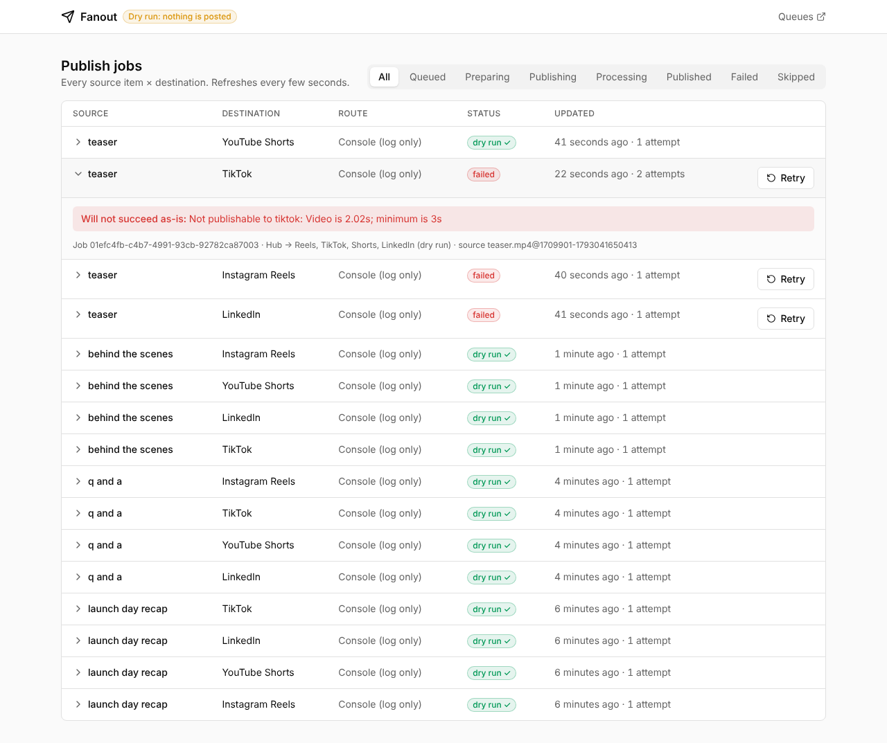

# Fanout

Self-hosted content repurposing: watch a source, normalize each video per platform, adapt the caption per platform, and publish everywhere — immediately or on a schedule. A repurpose.io alternative you run with your own accounts and keys.

> **Status:** Phase 0 (skeleton + dry-run pipeline). Nothing is posted anywhere yet; every destination is served by the `ConsolePublisher`, which validates, renders and logs the exact post. See [PROGRESS.md](./PROGRESS.md).



Watch the 2-minute demo recorded from the running app: [docs/fanout-phase-0-demo.mp4](docs/fanout-phase-0-demo.mp4).

## Quick start

```bash
docker compose up --build        # postgres, valkey, s3, api, worker, web
open http://localhost:8080       # dashboard (Bull Board at /admin/queues)
cp my-video.mp4 hub/             # optional caption: hub/my-video.txt
```

Within a few seconds the dashboard shows one job per destination (Instagram Reels, TikTok, YouTube Shorts, LinkedIn). Expand a row to see the request that would have been sent.

Every default in `docker-compose.yml` is for local development. Before exposing anything, copy `.env.example` to `.env` and set `NODE_ENV=production` and a real `TOKEN_ENCRYPTION_KEY` (the app refuses the development key in production).

## How it works

```
hub folder ──watch──▶ ingest ──▶ fan-out ──▶ prepare ──▶ publish
  (cursor)        ffprobe +     1 job per     render per    rate limit → claim →
                  S3 master     destination   destination   validate → publish/dry-run
```

| Queue | Does | Guarantees |
|---|---|---|
| `watch` | Polls each source connection on a schedule | Cursor advances only after ingest jobs are enqueued |
| `ingest` | Fetches the master, rejects corrupt/too-short files, stores it once (content-addressed), fans out | Idempotent per (connection, external ID) |
| `prepare` | Renders the destination's file (or reuses an identical render) | One encode per distinct output, even under concurrency |
| `publish` | Rate-limits, claims the job, validates against platform limits, publishes | A job is published at most once (atomic status claim) |
| `maintenance` | Deletes expired renditions (default 7 days) | Masters are never auto-deleted |

Error types drive retries: `RetryableError` (429/5xx/timeouts) retries with backoff that honours `Retry-After`; `PermanentError` fails immediately with a message shown in the dashboard; `ReauthRequiredError` fails and flags the connection `needs_reauth`.

## Repository layout

```
apps/
  api/        Fastify HTTP API + Bull Board
  worker/     BullMQ processors (watch, ingest, prepare, publish, maintenance)
  web/        React dashboard (TanStack Router + Query, Tailwind, shadcn-style UI)
packages/
  domain/       Pure types and rules: statuses, fan-out, idempotency, platform capabilities. No I/O.
  config/       Environment schema (Zod), validated once at startup
  logging/      pino logger, correlation IDs, secret redaction
  database/     Drizzle schema, migrations, repositories, AES-256-GCM token cipher
  queue/        Queue names, payload schemas, rate limiter, render lock, error policy
  storage/      S3 abstraction (+ in-memory double), presigned URLs, key layout
  media/        ffprobe/ffmpeg wrapper, media profiles, conformance, render fingerprints
  captions/     Template engine, hashtag sets, platform limits, CaptionRewriter
  api-contract/ Zod schemas shared by the API and the dashboard
  connectors/
    core/          SourceWatcher, Publisher, OAuthProvider, RateLimitPolicy, registry, HTTP client
    console/       ConsolePublisher for every destination kind
    local-folder/  Hub folder watcher
  testing/      Fixtures, factories, MSW and Testcontainers helpers
```

## Adding a platform

1. Create `packages/connectors/<platform>` implementing `Publisher` and/or `SourceWatcher` from `@fanout/connectors-core`.
2. Export a `ConnectorModule` and add it to `apps/worker/src/connectorModules.ts`.

Publishers are looked up by `(route, destinationKind)`, so "TikTok via Buffer" and "TikTok direct" are two registrations, not a switch statement. Make every external call through the shared `HttpClient` from `PublishContext`: it handles timeouts, retries, audit logging and dry-run recording. In dry-run mode the same publisher code runs against a recording client that returns your `dryRunResponse`.

## Development

Requires Node.js ≥ 22.18 (24 LTS recommended), pnpm 10, ffmpeg, and Docker for integration tests.

```bash
pnpm install
pnpm lint && pnpm typecheck
pnpm test               # unit + contract (MSW)
pnpm test:integration   # Testcontainers: Postgres 17, Valkey 8, SeaweedFS S3
pnpm test:e2e           # Playwright against the built dashboard
pnpm db:generate        # after editing packages/database/src/schema.ts
```

There is no build step for backend packages: Node runs the TypeScript sources directly through native type stripping (`erasableSyntaxOnly`).

Behind a TLS-intercepting proxy, pass its CA to image builds: `docker build --secret id=extra_ca_certificates,src=proxy-ca.pem ...`.
